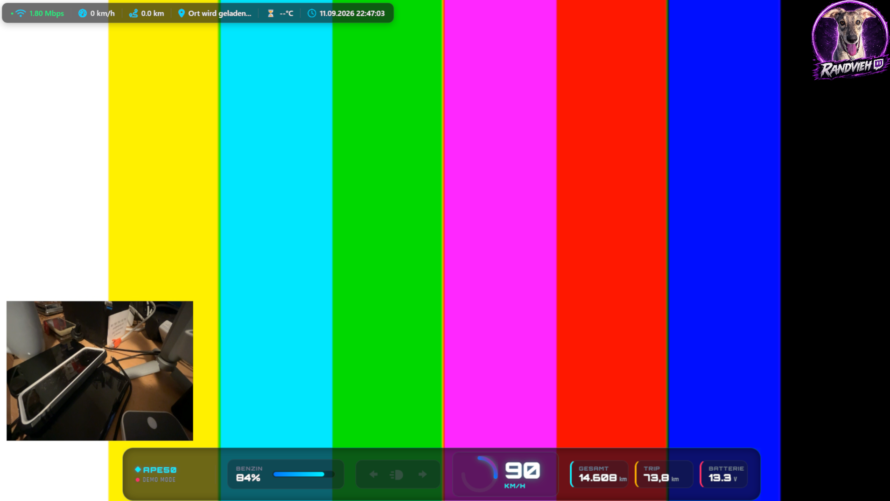
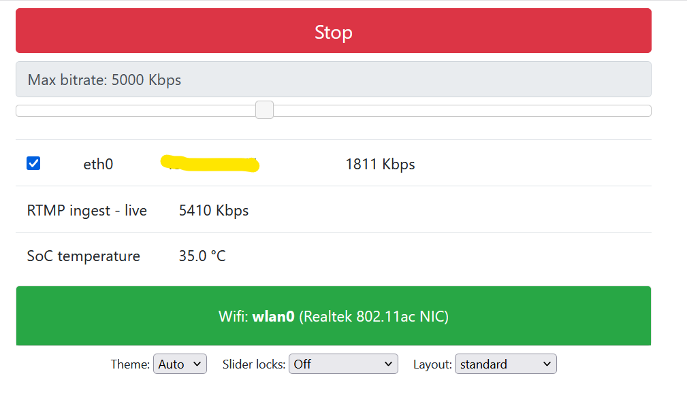

# BELABOX RTMP PiP Pipeline (`h265_camlink_1080p30_rtmp_pip`)

A custom hardware-accelerated pipeline for **BELABOX (NVIDIA Jetson)** that receives an incoming RTMP stream and overlays it as a Picture-in-Picture (PiP) window directly over your primary camera feed (e.g., Cam Link at 1080p30).




## 🚀 Features

* **Live RTMP Overlay:** Ingests a secondary stream sent to BELABOX and renders it as a Picture-in-Picture box over your main camera feed.
* **Auto show/hide (`…_rtmp_pip_auto`):** With the PiP mixer service, the PiP box disappears completely when the phone stream stops and comes back automatically when it resumes. No frozen frame, no placeholder, and no restart of the main stream (see [Auto show/hide](#-auto-showhide-pip-mixer)).
* **Hardware Accelerated:** Uses Jetson-native elements (`nvcompositor`, `nvv4l2decoder`, `nvv4l2h265enc`) for minimum latency and optimal performance.
* **Layout Specs:**
  * **Primary Video:** 1920x1080 @ 30 FPS (Cam Link / capture card)
  * **PiP Overlay Video:** 400x300 pixels positioned at `X=20, Y=650`
  * **Encoder:** H.265 / HEVC

## 🛠️ Installation

1. Connect to your BELABOX via SSH.
2. Create or copy the pipeline scripts into the `custom` pipelines folder, which belaUI provides for user pipelines (keeps them separate from the stock pipelines), i.e.:
   ```bash
   sudo mkdir -p /usr/share/belacoder/pipelines/custom
   sudo nano /usr/share/belacoder/pipelines/custom/h265_camlink_1080p30_rtmp_pip
   ```
   > If `belacoder_path` is set in belaUI's `setup.json`, the pipelines folder is `<belacoder_path>/pipeline/custom/` instead.
3. Paste the contents of the [Pipeline Script](#-pipeline-script) section below into the file and save it (`Ctrl+O`, `Enter`, then `Ctrl+X`).
4. Restart belaUI so it picks up the new pipeline (it reads the pipeline list only at startup):
   ```bash
   sudo systemctl restart belaUI
   ```

## 💻 Usage Guide

1. **Connect Primary Source:** Connect your main video camera to the BELABOX capture card as usual.
2. **Send Secondary Stream:** Broadcast your second video source (e.g., from a phone using Larix Broadcaster, or OBS) to the BELABOX RTMP ingest URL:
   ```text
   rtmp://<IP_ADDR_BELABOX>/publish/live
   ```
3. **Select Pipeline in Web UI:** Open the BELABOX Web UI and select the new encoder:
   ```text
   custom/h265_camlink_1080p30_rtmp_pip
   ```
4. **Start Stream:** Click **Start** in the BELABOX UI. The incoming RTMP stream will appear as a PiP overlay over your main camera feed.

## 👻 Auto show/hide (PiP mixer)

Plain `rtmpsrc` cannot reconnect. If the phone stops sending, the PiP freezes on its last frame (or the stream stops), and it does not come back without restarting the stream.

`h265_camlink_1080p30_rtmp_pip_auto` fixes this with a small helper service, [`mixer/belabox_pip_mixer.py`](mixer/belabox_pip_mixer.py):

* It pulls `rtmp://127.0.0.1/publish/live`, decodes it in hardware to 400x300 RGBA, and passes it to belacoder via shared memory (`/run/belabox-pip/pip.sock`) at a constant 30 fps.
* If no phone frame arrives for 0.5 s, it sends fully transparent frames (`0,0,0,0`), so the PiP vanishes. It reconnects automatically, and the PiP reappears as soon as the phone sends again.
* belacoder keeps running the whole time. The phone stream may also start after the BELABOX stream.
* Audio comes from the capture card (or any USB audio device, e.g. a wireless mic receiver, selected in belaUI). The phone's audio is not used.

Installation (on the BELABOX, Ubuntu 18.04 / GStreamer 1.14):

```bash
sudo apt-get install python3-gst-1.0 gir1.2-gst-plugins-base-1.0
sudo install -m 755 mixer/belabox_pip_mixer.py /usr/local/bin/
sudo install -m 644 mixer/belabox-pip-mixer.service /etc/systemd/system/
sudo systemctl daemon-reload && sudo systemctl enable --now belabox-pip-mixer
sudo install -m 644 h265_camlink_1080p30_rtmp_pip_auto /usr/share/belacoder/pipelines/custom/
sudo systemctl restart belaUI
```

Then select `custom/h265_camlink_1080p30_rtmp_pip_auto` in the Web UI. Logs: `journalctl -u belabox-pip-mixer`.
Settings (environment variables in the service file): `PIP_WIDTH`, `PIP_HEIGHT`, `PIP_FPS`, `PIP_HIDE_AFTER`, `PIP_RTMP_URL`.
If you change the size, change it in the pipeline (`shmsrc` caps and `sink_1::width/height`) as well.

Notes from testing (Jetson Nano 2GB, L4T / GStreamer 1.14):
* `nvcompositor` blends with premultiplied alpha, so "invisible" must be exactly `(0,0,0,0)`. `compositor background=transparent` produces `(255,255,255,0)`, which shows up as a white box.
* `rtmpsrc` does not report a lost publisher (no error, no EOS). The mixer therefore uses a watchdog.
* The `_reverse` pipelines still use `rtmpsrc` directly. There the phone is the 1080p main picture, and pushing 1080p RGBA through the mixer would be too heavy for the Nano.

## 📄 Pipeline Script

File location: `/usr/share/belacoder/pipelines/custom/h265_camlink_1080p30_rtmp_pip`

```gstreamer
v4l2src ! identity name=ptsfixup signal-handoffs=TRUE ! identity drop-buffer-flags=GST_BUFFER_FLAG_DROPPABLE !
identity name=v_delay signal-handoffs=TRUE !
videorate ! video/x-raw,framerate=30/1 !
textoverlay text='' valignment=top halignment=right font-desc="Monospace, 5" name=overlay ! queue !
nvvidconv interpolation-method=5 ! video/x-raw(memory:NVMM),width=1920,height=1080 ! comp.sink_0

rtmpsrc location=rtmp://127.0.0.1/publish/live ! flvdemux name=demux

demux.video ! queue max-size-time=2000000000 max-size-buffers=60 leaky=downstream !
h264parse ! nvv4l2decoder !
nvvidconv interpolation-method=5 ! video/x-raw(memory:NVMM),width=400,height=300 ! comp.sink_1

demux.audio ! queue leaky=downstream max-size-buffers=10 ! fakesink async=false

nvcompositor name=comp
sink_0::xpos=0 sink_0::ypos=0 sink_0::width=1920 sink_0::height=1080
sink_1::xpos=20 sink_1::ypos=650 sink_1::width=400 sink_1::height=300 !
video/x-raw(memory:NVMM),width=1920,height=1080 !
nvvidconv interpolation-method=5 ! video/x-raw(memory:NVMM),width=1920,height=1080 !
nvv4l2h265enc control-rate=1 qp-range="28,50:0,36:0,50" iframeinterval=60 preset-level=4 maxperf-enable=true EnableTwopassCBR=true insert-sps-pps=true name=venc_bps !
h265parse config-interval=-1 ! queue max-size-time=10000000000 max-size-buffers=1000 max-size-bytes=41943040 ! mux.

alsasrc device=hw:2 ! identity name=a_delay signal-handoffs=TRUE ! volume volume=1.0 !
audioconvert ! voaacenc bitrate=128000 ! aacparse ! queue max-size-time=10000000000 max-size-buffers=1000 ! mux.

mpegtsmux name=mux !
appsink name=appsink
```
[](https://youtu.be/Au6CxLGmDas)

## 📜 License

This project is licensed under the **MIT License**.

## 📬 Contact & Support

**Marc-Oliver Blumenauer**
   Twitch: [randvieh](https://www.twitch.tv/randvieh)
📧 Email: [randvieh@randvieh.de](mailto:randvieh@randvieh.de) 

[](https://ko-fi.com/randvieh)
